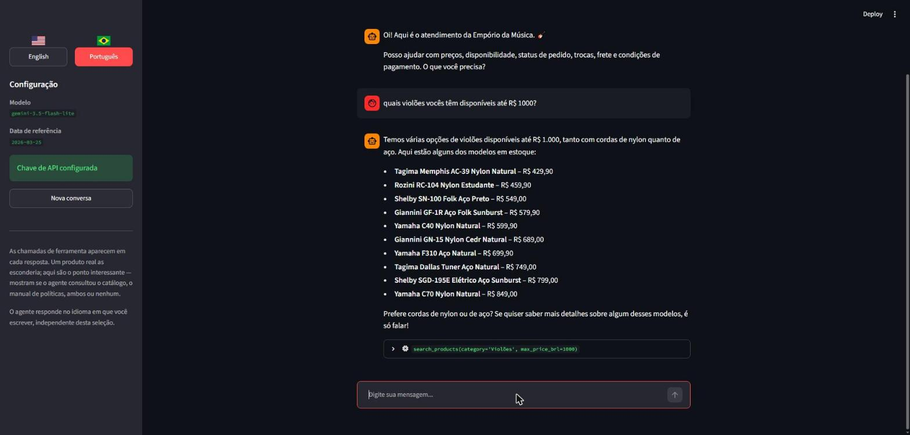
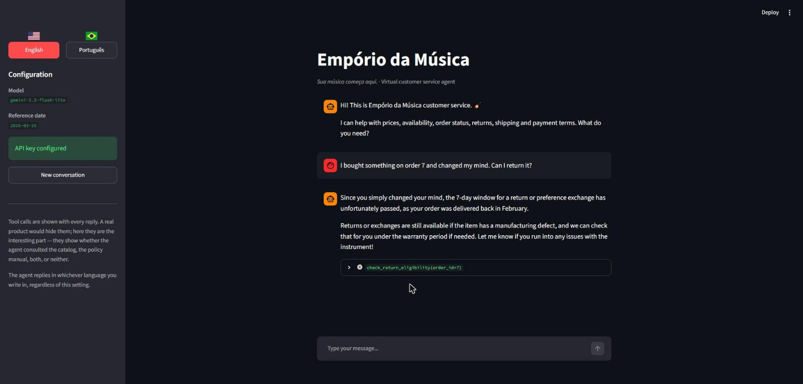
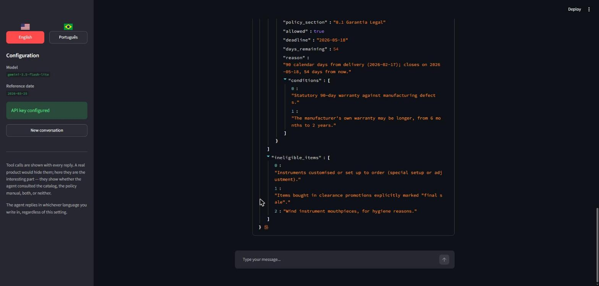

# Empório da Música — customer service agent

[](https://github.com/bbigelli/EmporioDaMusica/actions/workflows/ci.yml)

A prototype text-messaging agent that answers customer questions for Empório da
Música, a fictional musical instrument store in Campo Grande, MS, Brazil. It
exists to take the recurring questions — prices, availability, order status,
return rules, opening hours — off the store team's hands.

The agent works from two sources and has to know which one a question needs:

- **Operational data** (`data/raw/*.csv`) — catalog, stock, prices, promotions,
  orders, customers. Loaded into SQLite and exposed through typed tools.
- **The store policy manual** (`data/raw/store_policies.pdf`) — opening hours,
  payment terms, returns, shipping, warranty, service guidelines.

Five example conversations are in [`examples/`](examples/), including the two
non-trivial cases: a promotional price that must *not* stack with the PIX
discount, and a return request where every exchange window has expired but the
legal warranty has not.

## What it looks like

A catalog query with a price ceiling. The agent filtered to what is actually
purchasable — two further matches are out of stock or discontinued and are
deliberately not offered as buyable.



The same agent, in English, on the harder case: order 7 is past every exchange
deadline but still inside the legal warranty.



Every reply exposes the tool calls behind it. Expanding one shows the raw
result the model worked from — here the deadline arithmetic the agent is not
allowed to do itself.



## Quick start

```bash
python -m venv .venv
.venv\Scripts\activate          # Windows; use source .venv/bin/activate elsewhere
pip install -r requirements.txt

cp .env.example .env             # then put your key in GEMINI_API_KEY
```

Get a key at [Google AI Studio](https://aistudio.google.com/apikey) — it
creates a Cloud project for you and needs no billing details.

```bash
python -m emporio.cli                                   # interactive chat
python -m emporio.cli --lang pt                         # opening in Portuguese
python -m emporio.cli ask "quanto custa o Takamine GD20?"
streamlit run app.py                                    # web chat, with a 🇧🇷/🇺🇸 switch
```

Tool calls are shown inline. In a real product they would be hidden; here they
are the interesting part — they show whether the agent reached for the catalog,
the policy manual, both, or neither.

**Without an API key** you can still inspect everything the agent would see,
and run the whole test suite:

```bash
python -m emporio.cli tools --policy "posso devolver se me arrependi?"
python -m unittest discover -s tests -v                 # 124 tests, no key, no network
```

The generated data artifacts are committed, so neither pipeline needs to run.
They are only needed if a source file changes:

```bash
python scripts/build_data.py       # -> data/processed/store.db
python scripts/build_policies.py   # -> store_policies.md + policy_sections.json
```

## Technical decisions

### Model and provider: Gemini, but not the model you would expect

Gemini was chosen for its free tier: whoever evaluates this can run it without
paying. The model choice *within* Gemini was made by measurement, not by the
documentation.

`gemini-3.8-flash` is what Google documents for "autonomous agents and complex
enterprise workflows", so it was the default. On the free tier on 2026-10-31 it
returned `503 experiencing high demand` and, when it did respond, took **139.6
seconds** to answer a one-word prompt. `gemini-3.5-flash-lite` answered the same
prompt with a **median of 1.7 seconds** over three calls, and drives this
agent's tools correctly — including the compound case where a promotional price
must suppress the PIX discount.

Section 7.1 of the store manual holds this channel to a five-minute response
time. At 139 seconds for a trivial prompt, latency stops being a performance
concern and becomes a correctness one, so the lite model is the default.
`EMPORIO_MODEL` overrides it.

### Architecture: function calling with an explicit loop, no framework

The agent is a plain tool-use loop over the Gemini interactions API — about
forty lines in [`emporio/agent.py`](emporio/agent.py). LangGraph or Pydantic AI
would have added abstraction over a control flow that is already simple, and
the point of a prototype like this is that the decisions are visible rather
than configured inside a library.

Everything that matters is in that file and readable: when to stop, what
happens to a failed tool, how conversation state is threaded.

### Retrieval: SQL for data, BM25 for policy, and neither is a vector store

**Catalog and orders → SQLite with typed tools.** The CSVs are loaded at build
time into a schema with real types and foreign keys. Two business rules live in
the schema rather than the prompt, because a rule the model must remember is a
rule it can forget:

- The `product_pricing` view applies **only** active promotions and takes the
  single best discount rather than stacking — section 6.2 says promotions are
  not cumulative. 21 of the 25 promotions in the dataset are expired.
- The view derives an `availability` field, because `status` alone cannot
  answer "can the customer buy this today?". A product can be `active` with
  zero stock, or `discontinued` with stock remaining, and section 7.3
  prescribes a different response for each.

**No tool takes SQL.** A text-to-SQL agent answers a wider range of
unanticipated questions, but it does so by letting the model author the query
that produces a price or a stock figure, and an invented `JOIN` is a
plausible-looking way to check the system wrongly. The seven tools have closed
signatures over the store's own concepts:

| Tool | Source | Answers |
| --- | --- | --- |
| `search_products` | catalog | "which acoustic guitars under R$ 1000?" |
| `get_product_details` | catalog | "how much is the Takamine GD20, and how can I pay?" |
| `get_active_promotions` | catalog | "is anything on sale?" |
| `get_order_status` | orders | "where is order 7?" |
| `check_return_eligibility` | orders + rules | "can I still send it back?" |
| `quote_shipping` | rules | "what does delivery to São Paulo cost?" |
| `search_store_policies` | policy manual | "what are your opening hours?" |

Deciding between them is the agent's actual job, and it is the thing the
transcripts are there to show: the first six read operational data, the last
reads the manual, and some questions need both. "Does the PIX discount stack
with this promotion?" takes `get_product_details` *and* `get_active_promotions`
— that exchange is [example 2](examples/02-promotional-price-and-pix.md).

**Policy manual → BM25 over 25 sections.** The manual is eight pages, about
12,000 characters. At that size a vector store adds a dependency, a build step
and a per-query embedding call while buying no recall that lexical search does
not already have — policy questions reuse the document's own nouns: troca,
frete, garantia, boleto, horário.

Lexical search does break down in two places here, and both are vocabulary
problems rather than semantic ones, so they are fixed as such:

- **Portuguese morphology.** "posso parcelar em 10x" scored *zero* hits,
  because the manual says "Parcelamento" and "parcela". Prefix matching on five
  characters bridges it.
- **Cross-language querying.** The agent is bilingual; the corpus is not. A
  small expansion table maps English policy nouns onto Portuguese ones.

Terms are weighted by provenance — verbatim, translated, prefix-matched — so a
stemmed near-miss cannot outrank an exact hit. On the 15 cases in
`tests/test_tools.py`, recall@3 is 15/15 and top-1 is 12/15; the agent is given
three sections and chooses, so recall@3 is the metric that matters.

### Deterministic rules instead of model arithmetic

Deadlines, discounts, instalment tiers and shipping fees are computed in
[`emporio/rules.py`](emporio/rules.py), not by the model. Section 7.1 forbids
quoting a price or a deadline without checking the system, and arithmetic is
where a language model is least reliable and least auditable.

Returns are the clearest case. Four separate routes exist with deadlines
running from *different dates* — withdrawal and preference exchange from
delivery, defect exchange from purchase, legal warranty from delivery. All four
are evaluated and returned together, which is what lets the agent say "the 7
days are gone, but you are inside the 90-day warranty until 18 May" instead of
a flat no. That exchange is [example 3](examples/03-return-window-expired.md).

Money is rounded with `Decimal` and `ROUND_HALF_UP`, and formatted in Python.
Python's `round()` is wrong for currency twice over — it rounds halves to even,
and the float is usually already a hair under the half. A 5% PIX discount on
R$ 699,90 is 664.905, which `round()` turns into R$ 664,90 where every
Brazilian till gives R$ 664,91. Formatting is never left to the model either:
to a Brazilian reader `R$ 1.967,18` and `R$ 1,967.18` differ by a factor of a
thousand.

### Prompt strategy: split the manual by what it governs

The manual divides cleanly and the two halves are handled differently.
**Conduct** — section 7's tone, scope limits and special cases — goes in the
system instruction, because it governs every turn and a behavioural rule the
agent must remember to look up is one it will skip. **Facts** — deadlines,
percentages, fees — stay in tools, so an answer is computed from current data.

Embedding the whole manual in the prompt was the alternative. It removes a
round-trip and is marginally more accurate, but then the model re-derives each
deadline by reading prompt text, and that is not "checking the system".

The reference date is stated explicitly in the instruction, because every
deadline in the manual is relative and a model assuming its own training-time
date computes every window wrongly.

### Conversation persistence

The interactions API keeps history server-side; each turn passes the previous
interaction's id and the service rebuilds context with the model's reasoning
steps and their signatures intact. The alternative, `store=False`, means
replaying every step by hand and getting the signatures right.

That is enough for the model and not enough for anyone else, so conversations
are also written to SQLite ([`emporio/sessions.py`](emporio/sessions.py)):

```bash
python -m emporio.cli --resume last    # continue where you left off
python -m emporio.cli sessions         # list recorded conversations
python -m emporio.cli --ephemeral      # opt out
```

Three reasons the local copy exists. Retention of the server-side id is
undocumented, so a resume feature built only on it works until it silently
does not. An interaction id is not a transcript — a human reopening
yesterday's thread wants to *read* it. And when a customer disputes what they
were told, the record that matters is which tools ran with which arguments.

When the server-side id has expired, the next turn starts a fresh server
thread rather than failing: the model loses its memory of earlier turns, which
is bad, but less bad than a conversation that cannot be continued at all.

### Data and PDF handling

`products.specs` is a JSON document serialised inside a CSV cell, with keys
that vary by instrument family. It is parsed once at build time into queryable
columns, with the original kept intact.

The policy PDF is converted offline, because extraction quality varies sharply
by tool and the failures are silent — the worst property a policy source can
have. Measured on this document:

| Method | Result |
| --- | --- |
| `pdftotext -layout` | reorders table cells: opening hours come out as "Segunda a Sexta-feira → Fechado" |
| `pdftotext` (default) | encodes to latin-1, mangling every accent |
| `pypdf` default mode | one word per line; all structure lost |
| `pypdf` layout mode | reconstructs every table correctly |

The pipeline uses `pypdf` layout mode and additionally pins the four tables to
curated markdown, with every cell asserted against the extracted text. If the
PDF changes, the build fails rather than shipping a stale refund window or
closing time. A generated [data quality
report](docs/data-quality-report.md) records what the raw data actually
contains, measured at build time rather than transcribed by hand.

### Things the source documents get wrong

The manual contradicts itself, and the agent is told so explicitly rather than
being left to repeat the errors:

- It claims "mais de 300 instrumentos"; the catalog has 65. The agent never
  quotes catalog size or availability from the manual.
- Two different phone numbers appear. Both are reported with their context —
  store line vs WhatsApp channel.
- The email is spelled `contato@empóriodamusica.com.br` in section 1.2 and
  without the accent on the cover. The unaccented form is the valid one;
  domains do not take accents without IDN.

Two further ambiguities are resolved in `rules.py` and flagged here:

- Section 3's table states a flat R$ 100 instalment minimum while section 3.1
  gives per-tier minimums of none / 80 / 100. The more specific rule wins.
- Section 3.1's "sem valor mínimo de parcela (exceto abaixo de R$ 50,00)" is
  read as a floor on the individual instalment, not on the purchase.

### The reference date

The supplied orders span 2026-01 to 2026-03-22. Every deadline in the manual
runs from a purchase or delivery date, so running against a real clock months
later expires all of them and makes the returns policy impossible to exercise
or demonstrate.

"Today" therefore comes from `EMPORIO_REFERENCE_DATE`, defaulting to
`2026-03-25` — just after the data ends, so no order sits in the future. Set it
empty to use the system clock.

A consequence worth stating: at that date **no order is inside the 7-day
withdrawal window**, because the most recent delivery was 2026-02-17. Example 3
therefore shows the expired-but-still-covered path. To see an approval instead,
set `EMPORIO_REFERENCE_DATE=2026-02-20` and ask about order 7 — at the cost of
several later orders then being dated in the future.

### Language

The rule is one line: **everything written in this repository is English;
everything the customer reads follows the customer.**

| Layer | Language | Why |
| --- | --- | --- |
| Code, comments, commits, README | English | Engineering artifacts |
| CLI labels | English | Developer surface |
| Streamlit interface | 🇧🇷 / 🇺🇸 switchable | A reviewer and a store employee want different ones |
| Everything in a tool result | English | Keys, statuses *and* prose: `summary`, `conditions`, `availability_label`. Written here, so written in English |
| Catalog data and policy text | Portuguese | Supplied *data*, not code — see below |
| Agent replies | Mirrors the customer | Portuguese in, Portuguese out; English in, English out |

The Streamlit sidebar has a 🇧🇷 / 🇺🇸 selector. It switches the interface copy
and the language the agent opens in, without locking it: write in the other
language and the reply follows you. The CLI takes `--lang en|pt` for the same
purpose. Changing the selection clears the thread, because the choice is baked
into the system instruction and a half-switched conversation reads worse than
a fresh one.

**Two things stay in Portuguese, deliberately.** Catalog values from the CSVs
(product names, categories, descriptions) and the policy text returned by
`search_store_policies`, extracted from the store's own PDF. Those are the
sources the challenge supplied; translating them in the pipeline would put an
unverifiable paraphrase of a legal term — "direito de arrependimento", "garantia
legal" — between the manual and the customer, with nothing to check it against.
The agent translates them at reply time instead, which is visible in
[example 5](examples/05-english-customer-shipping.md): English question,
English answer, Portuguese policy section underneath it.

The reverse trip is the common one and worth checking too. The tool layer now
answers in English and the customer is usually Brazilian, so almost every reply
is a translation — [example 3](examples/03-return-window-expired.md) turns an
English `conditions` list back into the correct Brazilian consumer-law wording.

This did not work on the first attempt. The rule existed but sat mid-prompt,
and the first generated run of [example
5](examples/05-english-customer-shipping.md) answered an English-speaking
customer in Portuguese across all three turns — the surrounding Portuguese
context outweighed a single mention. It now appears second and again as a
closing check, and states explicitly that Portuguese source material is not a
signal about which language to reply in.

## Testing and evaluation

Two layers, because they answer different questions.

### Unit tests — does the machinery work?

```bash
python -m unittest discover -s tests -v    # 124 tests, no key, no network
```

The agent loop runs against a stub interactions client, so its real decisions
are covered without a model: tool-failure handling, the six-round cap on
runaway loops, retry and backoff, conversation threading, and persistence.

### Evals — does the *agent* answer correctly?

```bash
python -m evals.run                        # 25 cases against the live API
python -m evals.run --only pix --fail-under 0.9
```

Everything above can be verified without a model. Whether the agent gives the
right answer cannot, and until this existed it was checked by reading five
transcripts by hand — which does not scale past one prompt change and does not
catch regressions. The language bug in example 5 survived exactly because
nothing was watching for it.

Each case in [`evals/cases.json`](evals/cases.json) asserts things that are
true or false without judgement: substrings, regexes, which tools were called,
reply length, and **grounding** — every `R$` amount in a reply must appear in a
tool result from that same turn. There is no LLM-as-judge: a grader that can
drift is worse than no grader, and a run has to be cheap enough to repeat. The
cost is that tone is not graded. A judge pass would be a second layer, not a
replacement.

The suite earned its keep immediately by catching two bad assertions of my own.
One banned any price when asked about a missing product, and failed a reply
that correctly said the Roland Jupiter-8 is not stocked and offered a real
alternative at its real price — which is what section 7.3 asks for. The other
matched the literal `"não localiz"` and failed `"Não consegui localizar"`,
testing the wording rather than the behaviour.

Latest run: **25/25 in 184s**, recorded in [`evals/report.md`](evals/report.md).

### CI

GitHub Actions runs the unit tests on Python 3.11 and 3.13, and regenerates
both pipelines to confirm the committed artifacts still match their sources —
a generated file that has silently drifted from the CSVs or the PDF is the
failure the curated-table verification exists to prevent. The eval suite needs
an API key, so it runs on manual dispatch rather than on every push.

### Regressions locked by tests

Several tests exist specifically to lock defects that already happened:

- Opening hours are asserted cell by cell, against the `pdftotext` scrambling.
- Accents are asserted in the database, the policy markdown and the prompt.
- Promotional discounts are verified not to stack, using a synthetic second
  active promotion, since the shipped data has none.
- The scenarios are checked against live data, so an example cannot quietly
  stop demonstrating the thing its description claims.

Two bugs were found by tests rather than by me. Applying the R$ 50 instalment
floor to a single payment would have made any item under R$ 50 unpayable by
card — 1x is paying in full, not instalment credit. And an order already in
transit was being told it "can be cancelled before dispatch", contradicting its
own status in the same sentence.

## Known limitations

- **Delivery date is estimated.** The data has `estimated_delivery`, not the
  date the customer took possession. For delivered orders it is used as a proxy
  and flagged as such in the tool result. Real deadline arithmetic needs the
  actual receipt date.
- **No customer identity.** Anyone can query any order by number. A real
  deployment needs the order number bound to an authenticated customer — this
  prototype would otherwise leak names, cities and purchase history.
- **Shipping is not quoted outside Campo Grande.** The fee depends on postcode,
  weight and dimensions, none of which are in the data, so the agent returns
  carriers and estimates but no amount. Inventing one is exactly the
  "propaganda enganosa" the manual warns about.
- **Retrieval is tuned on 15 hand-written queries.** Enough to catch gross
  failures, not enough to claim a recall figure that generalises.
- **Free-tier rate limits are handled only by retry.** Three attempts with
  exponential backoff, then the error surfaces.
- **No streaming.** Replies appear all at once. At a ~2s median that is
  tolerable; on a slower model it would not be.

### With more time

Bind orders to an authenticated customer — the one limitation above that is a
real defect rather than a scope boundary. Build an evaluation set of graded
question/answer pairs and run it on every change, instead of reading five
transcripts by hand. Stream replies. Add a handoff that opens a ticket for the
human team rather than only promising one. Expand retrieval testing to
adversarial phrasings: typos, slang, multi-intent messages.

## Use of AI assistants

This project was built with **Claude Code** (Opus 5), used as a pair rather
than a generator.

**Investigation before planning.** Before any code, I had it read all six CSVs
and the PDF and report what was actually there. That is where the useful
findings came from: the 21-vs-4 promotion split, the 12 orders with null
tracking, the dataset ending seven months before the system clock, and
`pdftotext -layout` scrambling the opening-hours table. The plan was built from
those findings rather than from the challenge description.

**Decisions stayed with me.** Provider, framework, interface and language
policy were presented as options with trade-offs and I chose; the assistant
then justified those choices in writing here.

**Verification over recall.** Where its knowledge could be stale, it checked.
The Gemini API turned out to have moved to `client.interactions.create` with
server-side state — not the `generate_content` shape in its training data — and
the current model IDs were different too. It inspected the installed SDK
directly to confirm the function-call step shape and the `GOOGLE_API_KEY` /
`GEMINI_API_KEY` precedence rather than guessing.

**Tests as the check on its own work.** Two real bugs surfaced that way, listed
under Testing. One test it wrote was itself wrong — it assumed "Fender
Stratocaster" was absent from the catalog when the catalog contains it — and
the fix was to the test, not the code.

**Measurement over documentation.** The model choice was reversed after timing
both models against the real API, rather than trusting Google's stated
positioning.

**Iteration on observed failure.** The language bug was invisible until the
first full transcript run. The fix was driven by what the model actually did,
then verified by rerunning the same scenario.
